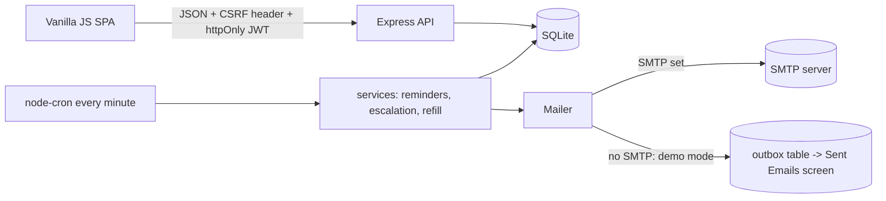

# CareCircle - Elderly Care & Medication Management Platform

A shared, passcode-protected care space where an elderly person, their caretakers and family manage medications, track adherence, watch doctor appointments and receive proactive email reminders. **The elder stays at the centre**: they can require approval for caretaker changes, regenerate passcodes and see a full activity log.

## Problem statement -> feature mapping
| Requirement | Where it is implemented |
|---|---|
| Daily medications, appointments, routines | Medicines / Appointments / Today views, `src/services.js` |
| Family and caretakers kept informed | Roles, email escalation chain, family notes, weekly digest |
| Shared ecosystem via secure **passcode** access | `POST /api/circles`, `POST /api/join` (bcrypt hashes, JWT httpOnly cookie, 3 role passcodes) |
| View / add / edit / manage schedules, track adherence | `/api/meds`, `/api/doses`, `/api/adherence`, rings, 7/30-day chart, heatmap |
| Monitor upcoming doctor appointments | `/api/appointments`, countdown, `.ics` download |
| Email reminders: upcoming, **missed**, appointments | `runOnce()` in `src/services.js` (cron every minute, idempotent via `notifications_sent`) |
| Beyond a basic reminder app | Escalation chain, refill predictor, wellness check-in, voice assist, SOS, safety notes, Simple Mode, doctor summary (print/JSON), family notes |
| Elder at the centre of decisions | Approval queue, passcode regenerate/revoke, activity log, elder-only settings |

## Architecture


## Reminder rules
- Upcoming dose: 15 min before -> elder. Missed: 30 min after -> elder; 60 min after still unconfirmed -> caretakers + family.
- Appointments: 24 h and 2 h before -> everyone. Refill: under 5 days of pills left -> elder + caretakers. Weekly digest Sunday 09:00 (plus "Send test digest now").

## Security notes
helmet + strict CSP (no inline script/style), bcrypt-hashed passcodes (shown once), rate-limited login (5 / 15 min / IP), generic auth errors, httpOnly + SameSite=Strict (+Secure in production) cookie, CSRF custom-header check, zod validation (strict schemas) on every route, parameterised SQL only, every query scoped by the circle id from the signed token (no IDOR), role middleware on every route, 20 kb body limit, no stack traces leaked, `.env.example` only.

## Accessibility notes (WCAG 2.1 AA)
Landmarks, skip link, visible focus rings, full keyboard use, native `<dialog>` focus trapping, labelled fields with errors linked via `aria-describedby`, `aria-live` toasts, icons + text (never colour alone), 48 px tap targets, 18 px base font with A-/A/A+, dark / light / high-contrast themes, `prefers-reduced-motion` support, `lang` set.

## Run locally
```bash
npm install
cp .env.example .env   # optional
npm start              # http://localhost:8080
npm test               # 34 tests + coverage
npm run lint
```
**Demo credentials** (seeded): circle `DEMO2026` - passcodes `ELDER-2026`, `CARER-2026`, `FAMILY-2026`. Elder: Ramesh (72), 4 medicines, 2 appointments, 14 days of history.

## SMTP
Set `SMTP_HOST`, `SMTP_PORT`, `SMTP_USER`, `SMTP_PASS`, `MAIL_FROM`. Without them the app runs in demo mode and every email appears in Circle -> Sent emails.

## Deploy to Google Cloud Run
```bash
gcloud run deploy carecircle --source . --allow-unauthenticated --region asia-south1 \
  --min-instances 1 --max-instances 1 --no-cpu-throttling \
  --set-env-vars NODE_ENV=production,JWT_SECRET=$(openssl rand -hex 32)
```
`min-instances 1` and `--no-cpu-throttling` keep the in-process scheduler running. SQLite lives in the container (`/data`), so data resets on redeploy and the demo circle is re-seeded automatically; use a persistent volume or Cloud SQL for real use.
